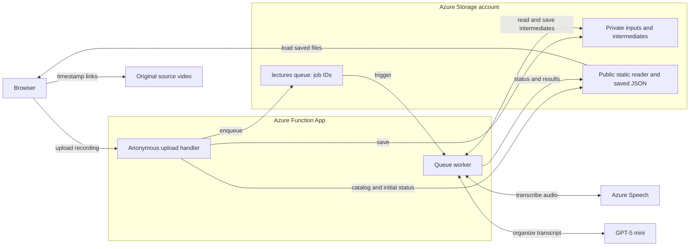

# StudyNotes 2.0 architecture

One Function App processes uploads; one Storage account holds the queue, private
inputs and public reader. Azure Speech and GPT-5 mini provide the AI steps.

The upload request returns without waiting for AI. Each worker invocation runs
**FFmpeg → Speech → GPT-5 mini → validation → publication** sequentially. The model
adds chapter boundaries, an overview and key terms; every transcript passage is
retained. Worker instances can scale for experiments.

The browser reads saved JSON, searches locally and exports Markdown. Timestamp
links add the excerpt offset and play the original source, keeping uploaded
media private. Reading saved results makes no AI calls.

## Browser and source playback

The static reader ([web/app.js](web/app.js), [web/lib.mjs](web/lib.mjs)) loads the
catalog and lecture JSON directly from storage. It polls the selected pending
job every four seconds and caches ready results. Search and Markdown export
run locally; the small library needs no search service or database.

Search scans saved transcripts locally. Timestamp links use **transcript time +
excerpt offset** and open/embed the original YouTube or direct-media source.
The backend processes the uploaded file; playback depends on the original
source remaining available.

## Upload handler

[function_app.py](function_app.py) exposes anonymous `POST /api/jobs` and
`GET /api/health`. The upload handler validates the file, language, source URL
and optional offset/Trial ID. It stores private media/metadata, publishes an
initial status/catalog entry, queues the job ID and returns `202`.

The job ID hashes **file bytes + language + processing version + Trial ID**.
A duplicate returns the existing job with `200` and does not queue another run.
Changing only a title or source URL reuses the first submission's metadata.
The browser retries transient upload failures at most twice with the same inputs.

## Storage account and work queue

Persistence is grouped in [pipeline.py](pipeline.py)'s `Store` class.

| Location | Contents and role |
| --- | --- |
| Private `studynotes/jobs/<id>/` | Input, normalized WAV, metadata, transcript/notes, raw AI responses, claim/attempt markers and timing receipts. |
| Queue `lectures` | Job IDs only; triggers processing independently of the upload request. |
| Public `$web` | Reader assets, `catalog.json` and `lectures/<id>.json` status/results. |

Conditional ETags protect concurrent catalog additions. Workers update their
own lecture files. Saved JSON supplies progress and finished content without
a separate read/status API.

## Worker and AI services

The queue binding calls `process()` in [pipeline.py](pipeline.py). An atomic
claim prevents another delivery from processing the same job. Stages run
sequentially within each invocation:

1. **Audio preparation:** FFmpeg extracts 16 kHz mono PCM WAV and checks actual
   duration/size before an AI request. Prepared audio is saved privately.
2. **Azure Speech:** whole-file transcription uses the selected English/German
   locale. [core.py](core.py) converts phrases into stable segment IDs with
   start/end times and rejects invalid or unordered timestamps.
3. **GPT-5 mini and validation:** the model receives transcript segments and a
   strict JSON schema for chapter starts, overview points and key terms. Code
   checks references and chapter order; the reader retains every segment under
   those chapters. Validation establishes structure/coverage, not factual correctness.

Success publishes `{job, transcript, notes}` to the lecture file and marks it
`ready`. Normal processing errors publish `failed`; interrupted jobs retain
intermediate data for owner review. Raw provider responses remain private.

## Runtime and access boundaries

One Python Function App hosts upload and queue handlers, with ordinary functions
for each processing stage instead of Durable orchestration. Its managed identity
accesses application storage and AI through scoped roles. Host/deployment
connection settings stay in Azure.

The browser receives an API URL and limits, never service credentials. CORS
allows the reader origin; it does not restrict who can call the anonymous API.
There is no application login/access code; outputs are public group test material.

## Cost, recovery and deployment

Before a paid AI request, the worker reserves an attempt marker. Saved responses
are reused; an attempt without a saved response stops for review. Queue
redelivery cannot bypass the job claim. Recovery is manual, and exactly-once
provider execution is not guaranteed.

[manage.py](manage.py) provisions resources, builds the Python package on Linux
and publishes static assets. Default Flex hosting has no always-ready instances;
the configured ceiling is two instances per scale group, with one queue message
processed per worker instance. This is a concurrency setting, not a budget cap.

Default admission limits are 200 MiB / 90 minutes, with a 30-minute Flex worker
timeout. Long-recording performance and German quality need evaluation. Cold
starts and limited browser-side search scalability are accepted trade-offs.
See [operations](docs/operations.md) for all limits and failure recovery,
[README](README.md) for setup/cleanup, and [DEV-README](DEV-README.md) for changes.
